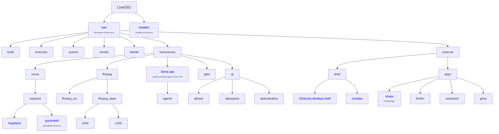

## Overview

The kan-linux organization on Github develops and supports the kan-linux and related projects.

### News
- `[2026 Oct 17]` [Kan-Linux v0.2.8 released](https://github.com/kan-linux/kan/releases/tag/v0.2.8)
- `[2026 Oct 10]` [Kan-Linux v0.2.7 released](https://github.com/kan-linux/kan/releases/tag/v0.2.7)
- `[2026 Oct 01]` [Kan-Linux v0.2.6 released](https://github.com/kan-linux/kan/releases/tag/v0.2.6)

